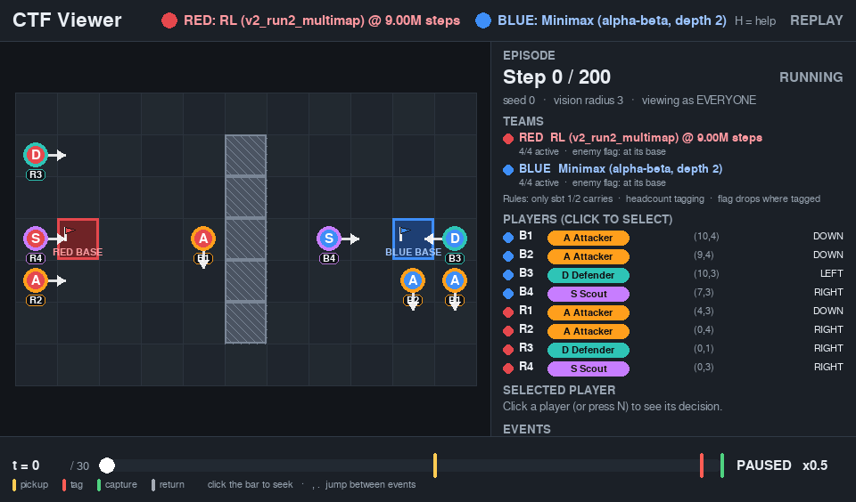
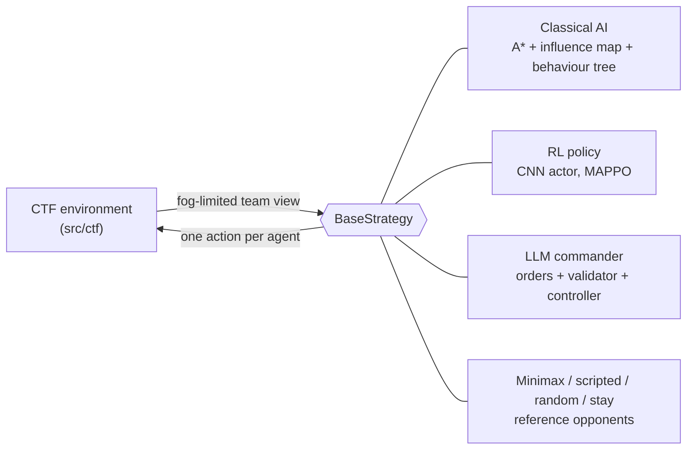
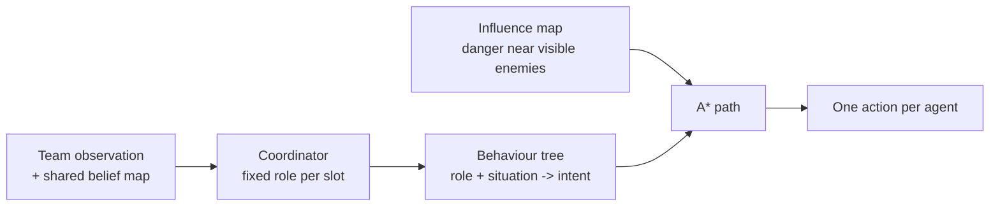
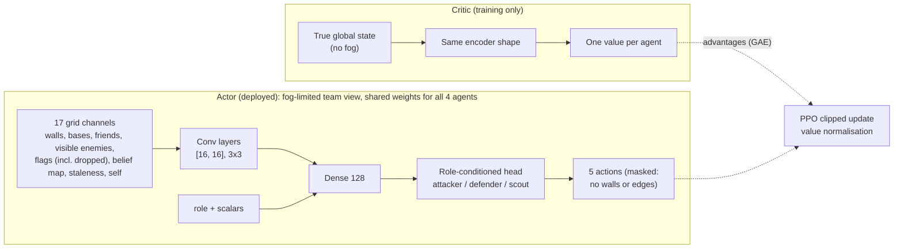
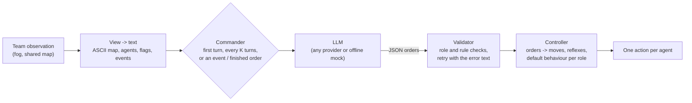
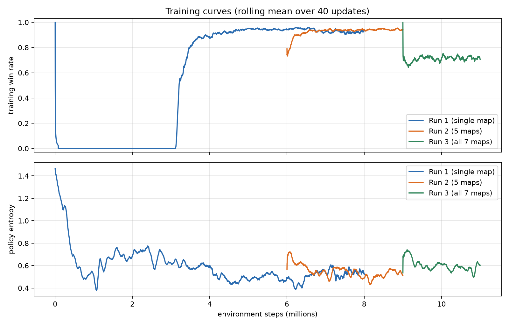
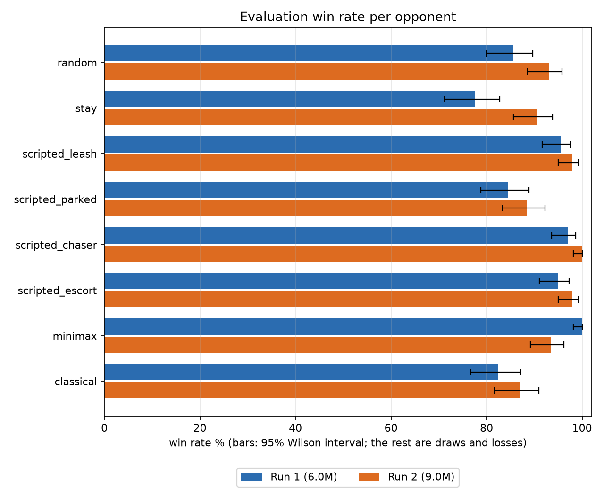
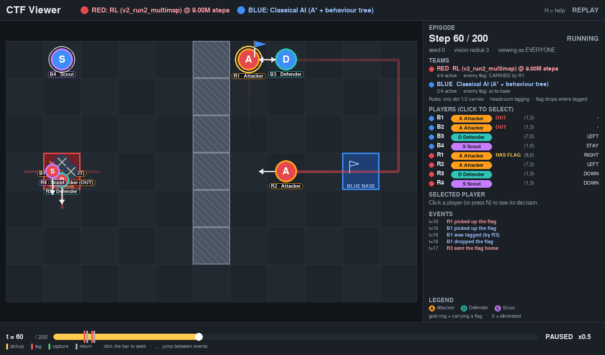
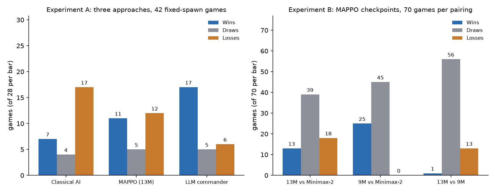
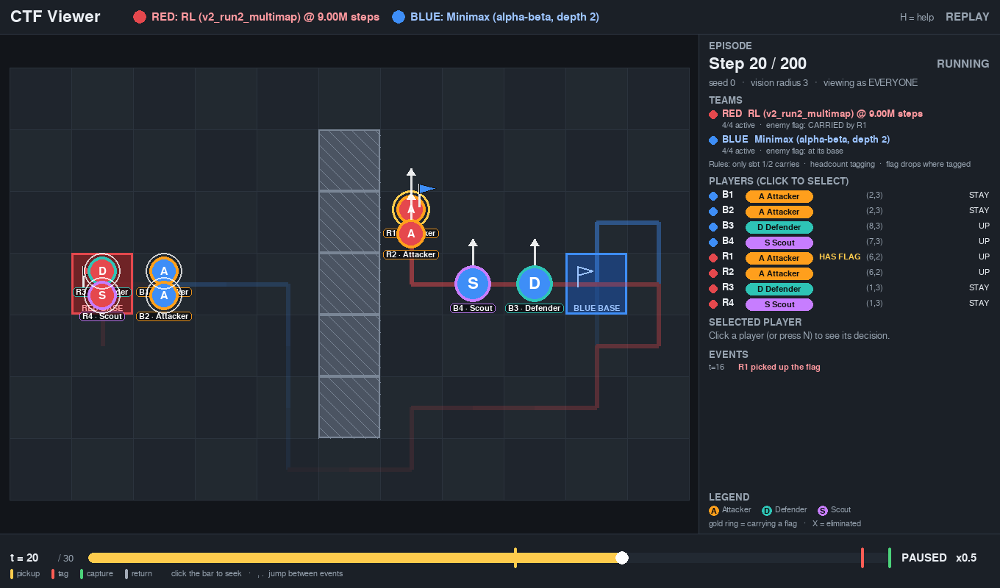

# Multi-Agent Capture the Flag

**One game, three ways to play it: a hand-written classical AI, a CNN trained with reinforcement learning (MAPPO), and
an LLM commander. A minimax search team is the fixed yardstick every approach can be measured against.**

Two teams of four agents fight over flags on a small grid with fog of war. This repository holds the game, the three
approaches, the minimax opponent, a fair evaluation harness, and a viewer in which any approach can play any other.

<p align="center">
  
  <br><em>RED (trained MAPPO policy) against BLUE (alpha-beta minimax, depth 2): both attackers go in together,
  the first one takes the flag, the defender and scout stay home. Recorded headless with <code>python -m viz record</code>.</em>
</p>

BITS Pilani, CS F407 Artificial Intelligence, course project.

## At a glance

| Approach | Idea | Learns? | Cost per decision | Headline evidence in this repository | Biggest caveat | Code |
|---|---|---|---|---|---|---|
| **Classical AI** | A* path finding, an influence map of enemy danger, a behaviour tree, one controller per role | no | about 0.5 ms per team (sandbox, one core) | with its v2 fixes it won 31 of 40 smoke games against minimax depth 2 (the original version 11 of 40) | cannot adapt; the original version drew 27 of 40 games against a parked guard | `src/classical_ai/` |
| **RL: MAPPO + CNN** | a small CNN actor-critic with role heads, trained against scripted opponents on a pool of maps | yes, up to 11.0M steps | not measured | 93.5% [89, 96] against minimax depth 2 and 87.0% [82, 91] against the classical AI (200 games each, 9.0M checkpoint) | does not transfer reliably to unseen layouts: 0.0% on `long_wall_south` | `src/rl/` |
| **LLM commander** | an LLM reads what the team knows and gives short orders; a controller carries them out | no training | a model call on the first turn, every K turns (default 5) and after important events; latency with a real provider not measured here | 17 / 5 / 6 (wins / draws / losses) in the report's 28-game Experiment A | no measurement on the v2 rules in this repository; the shipped viewer entries use an offline mock model | `src/strategies/llm_commander/` |
| **Minimax** (reference) | alpha-beta search a few game steps ahead on a fast copy of the rules | no | about 7-12 ms at depth 2 | the opponent all three are compared against (section 6) | a heuristic searcher: pessimistic reply model, ignores unseen enemies, hand-set weights | `src/rl/minimax.py` |

The evidence cells come from **different protocols and are not one ranking**; section 7.5 says exactly what can and
cannot be compared. The classical numbers are a 40-game smoke test, not the 200-game evaluation
([docs/classical.md](docs/classical.md)).

## Contents

1. [The game](#1-the-game)
2. [One interface, four kinds of player](#2-one-interface-four-kinds-of-player)
3. [Approach 1: Classical AI](#3-approach-1-classical-ai)
4. [Approach 2: RL with a CNN (MAPPO)](#4-approach-2-rl-with-a-cnn-mappo)
5. [Approach 3: LLM commander](#5-approach-3-llm-commander)
6. [Minimax, the reference opponent](#6-minimax-the-reference-opponent)
7. [Results](#7-results)
8. [The viewer: watch any approach play any other](#8-the-viewer-watch-any-approach-play-any-other)
9. [Quick start](#9-quick-start)
10. [Training, evaluating, reproducing the figures](#10-training-evaluating-reproducing-the-figures)
11. [What is in the repository](#11-what-is-in-the-repository)
12. [Limits and honest notes](#12-limits-and-honest-notes)
13. [Documentation index](#13-documentation-index)

## 1. The game

An 11x7 grid, a wall in the middle with gaps, one base and one flag per team, **4 agents per team** and a
200-step limit. A team wins by carrying the enemy flag back onto its own base cell. The environment
(`src/ctf`) is deterministic: randomness only enters through seeded spawn positions.

| Rule (`configs/ctf_v2.yaml`) | What it means |
|---|---|
| Fog of war | An agent sees enemies and the enemy flag only within Manhattan radius 3. Teammates share what they see (a team belief map), so a scout's view helps everyone. |
| Roles by slot | Slots 1-2 are **attackers** (only they may pick up and carry the flag), slot 3 is the **defender**, slot 4 the **scout**. |
| Headcount tagging | A carrier is tagged only when enemies on its cell **outnumber** its non-carrier teammates there. A lone attacker loses to one defender; an attacker with one escort beats one defender. |
| Dropped flags | A tagged carrier is eliminated (no respawn) and its flag stays where it fell. An eligible enemy can pick it up again; an agent of the flag's own team touching it sends it home. |
| Draws | If nobody captures within 200 steps the game is a draw. |

`configs/default.yaml` keeps the original rules (3 agents, any enemy tags, a tagged carrier's flag goes home) so older
results stay reproducible; those are called the *v1 rules* and the rules above the *v2 rules*. Every rule is a YAML key;
the full specification is [docs/environment.md](docs/environment.md).

Seven 11x7 layouts live in `configs/maps/`. They are all left-right mirror-symmetric (so one RL policy can play both
sides through a mirrored view). The picture shows which layouts each RL training recipe used:


## 2. One interface, four kinds of player

Every player implements the same small interface (`strategies.BaseStrategy`: a fog-limited team observation in, one
action per agent out). That is why any approach can play any other, in the evaluation harness and in the viewer.
A team is described by `{kind, label, params}` in strict YAML and built by `rl.opponents.build_opponent`; the kinds are
`random`, `stay`, `scripted` (four hand-written guard styles), `minimax`, `classical`, `llm` and `checkpoint` (a frozen
RL policy). The RL policy itself is loaded from a `.pt` file.



## 3. Approach 1: Classical AI

**Idea.** No learning. Each agent has a fixed role. A behaviour tree turns what the agent knows into an *intent* (go to a
cell, intercept, scout), and A* finds the path, avoiding cells that an influence map marks as dangerous because enemies
are near. A team-wide belief map shares what any agent has seen.



| Role (slots on the v2 map) | What it does (from the code) |
|---|---|
| Attacker (1-2) | A carrier goes home; otherwise it heads for the enemy flag, and for the enemy base while the flag is out of sight. |
| Defender (3) | Guards its own flag and moves towards a visible threat. |
| Scout (4) | Explores cells the team has not seen yet; its view is shared through the belief map. |

**v1 to v2.** The classical code was written for the v1 rules. `src/classical_ai/v2.py` is the layer for the 4-agent
rules; it subclasses the original roles and coordinator, so the original modules are untouched. Every addition has its own
key, and with all keys at their defaults the original behaviour runs, so old numbers stay comparable:

* a **fixed role table** per slot (the original assigns roles by position among the agents still active, which is wrong
  for four agents and shifts when an agent is tagged) and a real `reset()` between episodes;
* `remember_dropped_flag` and `defend_dropped_flag` for flags that stay where they drop;
* `buddy_system` and `intercept_in_pairs` for the headcount rule (attackers enter a guarded flag cell together; defender
  and scout wait together on the carrier's way home).

The entry `classical_fixed` turns the fixes on; plain `classical` is the original behaviour. Details, the smoke
measurements and what it still does not know: [docs/classical.md](docs/classical.md).

**Run it.**

```bash
uv run python -m viz play --map configs/ctf_v2.yaml --red "Classical AI, fixed" --blue Minimax
uv run python -m rl.evaluate --checkpoint $CK --opponents classical      # RL against the classical team
```

## 4. Approach 2: RL with a CNN (MAPPO)

**Idea.** "A CNN trained with reinforcement learning": the policy is a small convolutional network over image-like
channels of the board, trained with **MAPPO** (multi-agent PPO).



* **Parameter sharing, role conditioning.** One network plays every slot; the role is an input and each role has its own
  action head. BLUE plays through a mirrored view, so one policy handles both sides.
* **Centralised critic, decentralised actor.** The critic sees the true global state during training only; the deployed
  actor uses only what its team can see.
* **Reward shaping, all in YAML** (`configs/rl/default.yaml`): win/loss, flag pickup, being tagged, potential-based
  progress towards the enemy flag and towards home while carrying (BFS path distance), an escort bonus, a defender
  intercept term, a fading scout exploration bonus. Weights differ by role so nobody free-rides.
* **Curriculum.** Phase 1 full view and far-corner spawns, phase 2 radius 6 with guards, phase 3 the real setting
  (radius 3, every scripted opponent style, a pool of maps). Minimax is an evaluation opponent, not a training one.
* **Multi-map training.** Each episode draws a map from a weighted pool; features, reward distances and the opponent are
  built for the drawn map ([docs/multimap.md](docs/multimap.md)). A start-up check refuses a pool map that is
  not symmetric, not connected, or that leaks into the held-out evaluation maps.
* **Everything tunable lives in strict YAML** (unknown or missing keys are errors, old checkpoints are migrated).

Code map: `networks.py` (model), `mappo.py` (update), `features.py` (observation tensors), `rewards.py`,
`env_wrapper.py` (training environment), `curriculum.py`, `trainer.py`, `evaluate.py`, `league.py` (optional
frozen-opponent training), `minimax.py`, all in `src/rl/`.

**Run it.** Needs a checkpoint (`CK`, see section 11):

```bash
uv run python -m viz play --map configs/ctf_v2.yaml --checkpoint $CK --red RL --blue Minimax
uv run python -m rl.evaluate --checkpoint $CK                            # 200 games per opponent, Wilson intervals
```

## 5. Approach 3: LLM commander

**Idea.** The LLM is a coach, not a player. It never moves an agent. Every few turns it reads a text description of what
the team knows and answers with short orders such as "attacker, capture the flag" or "defender, block the gap at [5, 0]".
A low-level controller turns the orders into moves, and illegal orders are rejected before they reach the agents.



* **Commands.** `go_to`, `capture_flag`, `defend_base`, `intercept`, `scout`. Which role may use which command is fixed
  (an attacker may capture the flag, a defender may defend the base), and an order expires after 25 turns, after which the
  agent returns to the default behaviour of its role.
* **Reflexes in the controller.** A carrier always runs home, whatever its order. A defender that is defending the base
  chases the thief of its flag and touches a dropped own flag to send it home; an attacker told to capture the flag picks a
  dropped enemy flag up again.
* **Validator.** Every order is checked before use; a reply that is not valid JSON or contains illegal orders is sent back
  to the model with the error text (up to 2 retries), and the legal orders of the reply are kept.
* **Who executes the orders** (the *condition*): the simple BFS controller (`llm`), the classical team's A* and role logic
  (`llm_classical`) or the trained RL policy for the agents without an order (`llm_rl`). Ablations remove the validator, the map
  or the scout's shared view; `random_commander` gives random but legal orders as a control.
* **Providers.** Any OpenAI-style service, Anthropic, Gemini, OpenRouter, Groq and others, or a local model through
  Ollama or LM Studio. The key comes from an environment variable and is never written to a file. `cache:` stores
  every answer so a game can be replayed without the service.
* **The mock model.** The viewer entries shipped in this repository use an offline mock LLM that follows a few fixed
  rules. It is a plumbing test that needs no key. **It is not a result of the study.**

The commander follows the rules of the config in use (4 agents on `configs/ctf_v2.yaml`: attacker, attacker, defender,
scout). Full options, providers and the experiment pipeline: [docs/llm_commander.md](docs/llm_commander.md).

**Run it.**

```bash
uv run python scripts/run_llm_commander.py --config configs/ctf_v2.yaml            # mock LLM vs a scripted team
uv run python scripts/setup_llm.py                                                 # once, for a real provider
uv run python -m viz play --map configs/ctf_v2.yaml --red "LLM commander (mock model, classical" --blue "Classical AI, fixed"
```

## 6. Minimax, the reference opponent

`src/rl/minimax.py` is a classical *search* opponent, not one of the three approaches: it thinks a few game steps ahead
with a fast copy of the rules and picks the joint move with the best worst case. It is the strongest fixed opponent
the learned and the hand-written teams are measured against ([docs/minimax.md](docs/minimax.md)).

* **Search.** Our team picks a joint move (MAX), then the other team picks its worst reply (MIN), both are applied at
  once; `depth` counts game steps. With 625 joint moves per side, each agent tries only its best two moves, ranked by path
  distance to a target (carrier home, attacker to the enemy flag, defender to the threat).
* **Alpha-beta pruning** skips branches that cannot change the result: the same move and value as plain minimax with fewer
  simulated steps (`alpha_beta: false` runs plain minimax; a test checks both agree).
* **Honest about the fog.** It reads only its team's observation: visible enemies are simulated, unseen ones are ignored,
  and it remembers where it last saw a dropped flag.
* **A copy of the rules** (`_Sim`) is checked against the real environment after every step of random games on six rule
  variants (`tests/test_rl_minimax.py`).
* **Depth 2 is the default** (about 7-12 ms per decision, clearly stronger than depth 1 against the chaser and the parked
  guard). Depth 3 took about 30 ms per decision in the sandbox with its node cap hit and was not better in a small test, so
  it is not the default. Run 1 at 6.0M was also evaluated once against depth 3: 89 wins and 11 draws in 100 games
  (`outputs/eval/v2_run1_6.0M_minimax3.json`; against depth 2 the same checkpoint won 200 of 200).
* **Why it is not trained against.** It is milliseconds per decision against microseconds for the scripted teams, so it is
  kept as an evaluation opponent; the weights of its evaluation function are hand-set YAML values, not tuned.

## 7. Results

Everything in this section comes from files in the repository (`outputs/eval/*.json`, `runs/*/metrics.jsonl`),
except section 7.4, which is marked as copied from the research report. Evaluation protocol:
**200 games per opponent** (100 as RED, 100 as BLUE), fixed seed 2026, argmax actions, no opponent noise, random start
cells near the base, vision radius 3, Wilson 95% intervals (`configs/rl/eval.yaml`, [docs/evaluation.md](docs/evaluation.md)).
Only the RL approach has been through this protocol; the classical AI appears in it as an opponent.

### 7.1 How RL training went



* **Run 1** (single map) won almost nothing for about 3 million steps (a "grab the flag and freeze" start; the cause
  is a hypothesis, not a finding), then climbed quickly once it found the route home.
* **Run 2** continued from Run 1's 6.0M checkpoint on a pool of five maps (9.0M steps).
* **Run 3** continued from Run 2 on all seven maps (11.0M steps). Its lower overall training win rate is expected: the
  pool now includes the two hardest layouts.


Honest detail from `runs/v2_run3_allmaps/metrics.jsonl`: on `long_wall_south` the training win rate is **0.0 in all 976
logged updates** even though that map has weight 2 in the pool, while `center_gate` rose from 0.77 to 0.88 (mean of the
first and last 200 updates). More training on that map did not help in the 2M steps that were run.

### 7.2 RL against every fixed opponent (200 games each), classical AI and minimax included



| Opponent | Run 1 @ 6.0M (single map) | Run 2 @ 9.0M (5-map pool) |
|---|---|---|
| random | **85.5%** [80, 90] (D 29, L 0) | **93.0%** [89, 96] (D 14, L 0) |
| stay | **77.5%** [71, 83] (D 45, L 0) | **90.5%** [86, 94] (D 19, L 0) |
| scripted_leash | **95.5%** [92, 98] (D 8, L 1) | **98.0%** [95, 99] (D 4, L 0) |
| scripted_parked | **84.5%** [79, 89] (D 31, L 0) | **88.5%** [83, 92] (D 23, L 0) |
| scripted_chaser | **97.0%** [94, 99] (D 6, L 0) | **100.0%** [98, 100] (D 0, L 0) |
| scripted_escort | **95.0%** [91, 97] (D 10, L 0) | **98.0%** [95, 99] (D 4, L 0) |
| minimax (depth 2) | **100.0%** [98, 100] (D 0, L 0) | **93.5%** [89, 96] (D 13, L 0) |
| classical AI | **82.5%** [77, 87] (D 35, L 0) | **87.0%** [82, 91] (D 26, L 0) |

`[lo, hi]` is the Wilson 95% interval, D = draws, L = losses. Almost every non-win is a 200-step draw, not a loss.
Run 2 at 9.0M is *lower* than Run 1 against minimax (93.5% vs 100%): more training did not help against every
opponent. Files: `outputs/eval/v2_run1_6.0M.json`, `outputs/eval/v2_run2_9M.json`.

### 7.3 Does RL work on maps it has not seen?


| Map | Run 1 @ 6.0M | Run 2 @ 9.0M | Seen by Run 2? |
|---|---|---|---|
| center_gate | **5.0%** [3, 10] | **50.6%** [43, 58] | **UNSEEN** |
| center_pillar | **89.4%** [84, 93] | **95.6%** [91, 98] | seen |
| long_wall_south | **0.0%** [0, 2] | **0.0%** [0, 2] | **UNSEEN** |
| open_field | **45.0%** [37, 53] | **90.6%** [85, 94] | seen |
| pillars | **51.9%** [44, 59] | **91.9%** [87, 95] | seen |
| two_corridors | **36.9%** [30, 45] | **96.2%** [92, 98] | seen |

160 games per map (four scripted opponents x 40). Training on a map pool fixed the layouts it trained on. Of the two maps
Run 2 never saw, one is about half solved and the other, `long_wall_south` (a wall with only a *bottom* gap), is a clean
failure: the policy heads for the top lane that its single-map training taught it. The viewer shows it:



### 7.4 The three approaches side by side (copied from the research report)



These two experiments are **not regenerated from files in this repository**; the counts are copied from Figures 6 and 7
of the research report into `configs/plots/readme_assets.yaml` (the figure script checks that each bar sums to its game
count).

* **Experiment A:** 42 fixed-spawn games, 28 per strategy. Classical AI 7 wins / 4 draws / 17 losses, MAPPO (13M steps)
  11 / 5 / 12, LLM commander 17 / 5 / 6. The report itself calls this a descriptive sample, not evidence of statistical
  significance or a general ranking.
* **Experiment B:** 70 games per pairing, minimax depth 2. The 13M MAPPO checkpoint scored 13 / 39 / 18 against minimax,
  the 9M checkpoint 25 / 45 / 0, and 13M against 9M went 1 / 56 / 13. The 9M checkpoint's 25 wins came with 45 draws; it
  won no game against minimax on `center_gate`, `long_wall_south` or `open_field`, and all 30 games on `long_wall_south`
  across the three pairings were draws.

Fixed spawns and 28-70 games are a different protocol from the 200-game near-base evaluation above, so do not compare
numbers across 7.2 and 7.4. The report's game rules are not recorded in this repository; read the report before quoting
these counts.

### 7.5 What can and cannot be compared

* **Comparable:** RL against the classical AI, minimax and the scripted teams (7.2, 7.3): same v2 rules, same seeds, same
  spawn setting. Also the classical variants against each other and against minimax in the smoke test of
  [docs/classical.md](docs/classical.md) (40 games per cell, deterministic, not the 200-game evaluation).
* **Not comparable:** RL and the LLM commander in one table. They have not been measured against the same opponents under
  the same rules in this repository. **There is no number for the LLM commander on the v2 rules here**, and none for RL on
  the v1 rules. The classical team is the only bridge, because it plays both rule sets.
* **Not claimed:** that any approach is "the best". One training seed per RL run; the LLM experiment is a small descriptive
  sample.

## 8. The viewer: watch any approach play any other

`src/viz` is a Pygame viewer for live play and replays. Every player is labelled with its id and role, the right-hand
panel shows the rules, each agent's position and last action, an event log, and the bottom bar is a timeline with
pickup / tag / capture / return markers you can click to seek.



More recorded games (made with `python -m viz record`, no window needed). RL (RED) against the classical team, and a win
on `center_gate`, a layout Run 2 never trained on (a good seed, not the typical result, which is about half):

<p align="center">
  
  
</p>

**Any controller on either side.** The controllers come from `configs/viz/controllers.yaml`; `--red` / `--blue` take an
index or part of a label, and `F1` / `F2` cycle them in the window:

| Controller (label) | Approach |
|---|---|
| `RL (your run)` (needs `--checkpoint`) | RL |
| `Classical AI (A* + behaviour tree)`, `Classical AI, fixed (buddy rules, dropped flags)` | Classical |
| `LLM commander (mock model, simple controller)`, `LLM commander (mock model, classical controller)` | LLM |
| `Minimax (alpha-beta, depth 2)` | Minimax |
| `Scripted: ...` (leash, parked, chaser, escorted), `Random`, `Stay still` | reference opponents |

```bash
uv run python -m viz play --map configs/ctf_v2.yaml --checkpoint $CK --red RL --blue "Classical AI, fixed"
uv run python -m viz play --map configs/ctf_v2.yaml --red "LLM commander (mock model, classical" --blue "Classical AI, fixed"
uv run python -m viz play --map configs/ctf_v2.yaml --checkpoint $CK --red RL --blue "LLM commander (mock model, simple"
uv run python -m viz record --red "LLM commander" --blue Minimax --seed 3 --mp4 outputs/viz/llm_vs_minimax.mp4
```

For a real LLM in the viewer copy a `kind: llm` entry in `configs/viz/controllers.yaml` and set `provider` (and `model`).

| Other features | How |
|---|---|
| Keys, fog and vision | press **H** in the window for every key; `f` fog, `v` vision, `tab` view as RED / BLUE / everyone, `w` swaps sides, `return` new seed |
| Replays and exports | `viz record`, `viz replay`, `viz export` to GIF, MP4 or PNG |
| Map maker | `python -m viz mapmaker --map configs/maps/default.yaml`: paint walls, bases and spawns, with a mirror mode that keeps maps symmetric |
| Learning over time | `python -m viz timelapse --run runs/v2_run1`: the same game played by checkpoints from early to late training |
| Training report | `python -m viz report --run runs/v2_run1`: one-page training dashboard |

Looks and keys live in `configs/viz/default.yaml`. The headless rendering was verified in a Linux sandbox; opening the live
window on macOS is the one thing the checklist in [docs/demo.md](docs/demo.md) asks you to do once before presenting.

## 9. Quick start

Requires [uv](https://docs.astral.sh/uv/) (Python 3.11+).

```bash
uv sync --extra dev --extra rl --extra viz        # environment + tests + PyTorch + viewer
uv run pytest -q                                  # the test suite

uv run python scripts/run_demo.py                 # text demo of a scripted episode

# watch a trained team (needs the viz extra and a display)
CK=runs/v2_run2_multimap/checkpoints/step_0009000960.pt
sh scripts/demo_prepare.sh $CK                    # near-base spawn copies of the maps + fallback GIFs
uv run python -m viz play --map outputs/viz/demo_maps/default.yaml --checkpoint $CK --red RL --blue Minimax --seed 0
uv run python -m viz play --map outputs/viz/demo_maps/default.yaml --checkpoint $CK --red RL --blue "Classical AI (A*" --seed 0
```

The LLM commander runs offline with a mock model (no key needed) and with a real provider after
`uv run python scripts/setup_llm.py`:

```bash
uv run python scripts/run_llm_commander.py                                    # mock LLM vs a scripted team
uv run python scripts/run_llm_commander.py --config configs/ctf_v2.yaml --condition llm_rl --rl-checkpoint $CK
uv run python scripts/run_experiments.py --dry-run                            # plan of the evaluation matrix
```

## 10. Training, evaluating, reproducing the figures

```bash
# train (a run lives in runs/<run.name>/: metrics.jsonl, config.yaml, checkpoints/, tensorboard/)
uv run python -m rl.benchmark --workers 0 2 3 --updates 2            # pick workers / threads for your machine
uv run python -m rl.train --set run.name=my_run --set rollout.num_workers=3
uv run python -m rl.train --set run.name=my_run --set rollout.num_workers=3 --resume latest
uv run tensorboard --logdir runs

# evaluate without any training noise (200 games per opponent, Wilson intervals, held-out maps, role-swap and
# argmax-vs-sampled checks)
uv run python -m rl.evaluate --checkpoint runs/v2_run2_multimap/checkpoints/step_0009000960.pt
uv run python -m rl.evaluate --checkpoint ... --opponents random scripted_chaser --set episodes=40   # quick look
```

The evaluation list in `configs/rl/eval.yaml` holds random, stay, four scripted teams, minimax and both classical entries;
an LLM entry can be added the same way (`kind: llm`, see [docs/evaluation.md](docs/evaluation.md)).

The Colab commands behind the three runs (GPU, 2 workers, resume after a runtime restart, the exact `--set` flags) are in
`runs/*/run_info*.json` and in [docs/multimap.md](docs/multimap.md). Training speed was about 850 steps/s on a Colab T4 with 2
workers (an estimate from the first run; the sandbox used for verification manages 300-400 steps/s on one CPU core).

Rebuild every figure and screenshot of this README (no training or evaluation is run; it reads the committed files):

```bash
sh scripts/make_readme_assets.sh runs/v2_run2_multimap/checkpoints/step_0009000960.pt
```

This calls `scripts/make_rl_plots.py` (training curves, per-opponent and per-map bars), `scripts/make_readme_assets.py`
(map gallery and the report experiments) and `python -m viz record/export` (UI screenshots and GIFs); sizes and colours are in
`configs/plots/`.

## 11. What is in the repository

```
src/ctf/                 environment: rules, observations, config (strict YAML)
src/coordination/        shared team belief map (scout line-of-sight sharing)
src/strategies/          BaseStrategy interface, roles, the LLM commander (llm_commander/)
src/classical_ai/        approach 1: the original modules plus v2.py, the layer for the 4-agent rules
src/rl/                  approach 2: MAPPO, features, rewards, curriculum, evaluation, league, map pools; also minimax.py
src/viz/                 the viewer, map maker, GIF/MP4 export, time-lapse, training report
configs/                 default.yaml, ctf_v2.yaml (rules), maps/, rl/ (training + evaluation), viz/, plots/
runs/                    committed training logs and a few checkpoints (below)
outputs/eval/            committed evaluation results (JSON) and the review log
scripts/                 demos, LLM runner and experiments, plot and asset scripts, LLM setup
docs/                    specification, evaluation, minimax, classical, multi-map, LLM commander, demo checklist
tests/                   unit and integration tests
```

Checkpoints in the repository (the rest were removed to keep the repository small; every file keeps its config inside):

| File | What it is |
|---|---|
| `runs/colab_run1/checkpoints/latest.pt` | the first run: 3 agents, original rules, 2M steps (baseline only; cannot play the 4-agent maps) |
| `runs/v2_run1/checkpoints/step_0006000640.pt`, `step_0008001536.pt` | Run 1 on the v2 rules, single map, at 6.0M and 8.0M steps |
| `runs/v2_run1/checkpoints/step_0013002752.pt` | 13.0M steps; the config stored inside names it `v2_pickup_finetune_r2` (a single-map fine-tune, learning rate 0.00003). Its training command is not in the repository |
| `runs/v2_run2_multimap/checkpoints/step_0007501824.pt`, `step_0009000960.pt` | Run 2, five-map pool, 7.5M and 9.0M steps. The 9.0M file is the one the demos and tables use |
| `runs/v2_run3_allmaps/` | Run 3 (all seven maps, 11.0M steps): logs and in-training evaluations only, no checkpoint file |

## 12. Limits and honest notes

**All approaches**

* **Different rules are not comparable.** v1 results (3 agents) and v2 results (4 agents, headcount tagging) must not share a
  table. Fixed-spawn and near-base-spawn evaluations are different protocols too.
* **Not run by the authors of this README:** the live Pygame window on macOS, PyTorch 2.2.2 on macOS 12 (the sandbox used
  PyTorch 2.14), live Colab training, and any LLM provider other than the offline mock.

**Classical AI**

* Nothing is learned, so it cannot adapt. The original version often drew against a parked guard; the v2 fixes help in the
  smoke test but are a 40-game measurement per cell, and the behaviour tree itself (what each role wants) is unchanged.
* On the v1 rules the v2 layer runs without errors but is not tuned for them.

**RL**

* **One training seed per run**, so there is no seed-to-seed variance. Differences of a few points between checkpoints are
  inside the intervals.
* **Draws are the main non-win**, mostly 200-step timeouts. Against a team that never moves, the policy can still lose its
  attackers one by one to the headcount rule, which is a real weakness (traced in [docs/classical.md](docs/classical.md)).
* **Transfer is limited.** Only `center_gate` and `long_wall_south` were unseen for Run 2: about half, and zero. Layouts with a
  different size, non-symmetric walls, or very different base positions were never tried (the network shape contains the
  11x7 board, and the mirrored-BLUE trick needs symmetry).
* **More steps are not always better.** Run 2 at 9.0M is below Run 1 at 6.0M against minimax (table 7.2).
* **The scout often stands still.** Scout information sharing is a game rule (the team view is the union of all agents' views),
  not a tested hypothesis, and role specialisation is judged from behaviour numbers, not from the role-swap check.
* **Training win rate is not performance.** It includes sampled actions and opponent noise; only the 200-game evaluation
  counts.

**LLM commander**

* The shipped viewer entries use the **mock model**; nothing in this repository measures a real model on the v2 rules.
* With a real provider a game depends on an external service (latency, rate limits, cost, answers that change between
  runs); `cache:` makes a game replayable but does not make the model deterministic.
* The experiment of section 7.4 is a small descriptive sample copied from the report.

**Minimax**

* A heuristic searcher: pessimistic reply model, only the best moves per agent are searched, unseen enemies are ignored and the
  evaluation weights are hand-set. Beating it does not mean playing well in general.

## 13. Documentation index

| Document | About |
|---|---|
| [docs/environment.md](docs/environment.md) | full environment specification and rules |
| [docs/evaluation.md](docs/evaluation.md) | the evaluation protocol, metrics and checks |
| [docs/multimap.md](docs/multimap.md) | map pools, the seen/unseen split, Run 2 and Run 3 recipes |
| [docs/minimax.md](docs/minimax.md) | the alpha-beta minimax opponent |
| [docs/classical.md](docs/classical.md) | the classical AI, its v2 layer and fixes |
| [docs/llm_commander.md](docs/llm_commander.md) | the LLM commander, providers and experiments |
| [docs/demo.md](docs/demo.md) | live-demo checklist, one command per demo |
| [docs/research_handoff_rl.md](docs/research_handoff_rl.md) | numbers and what must not be claimed, for the research record |
