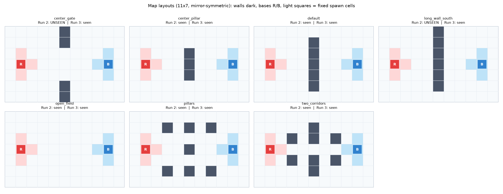
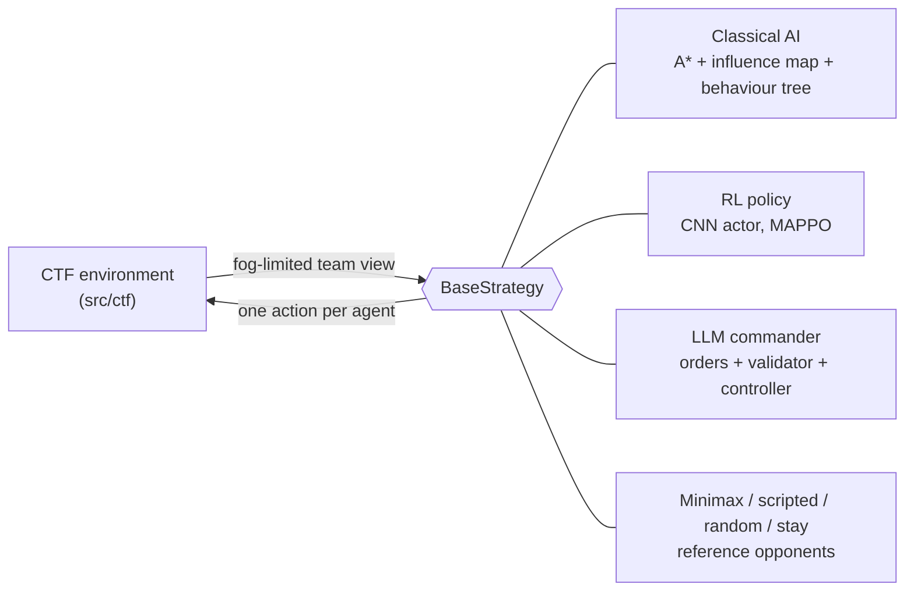
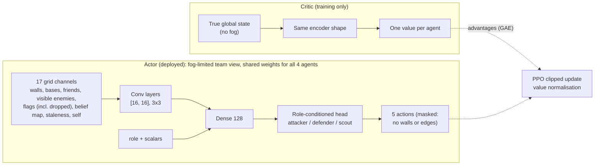
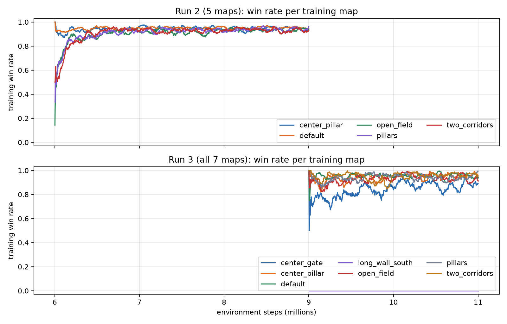
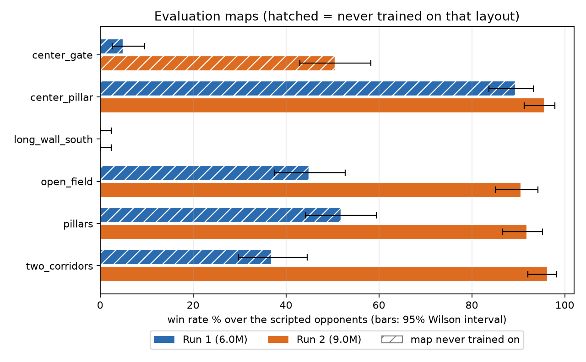
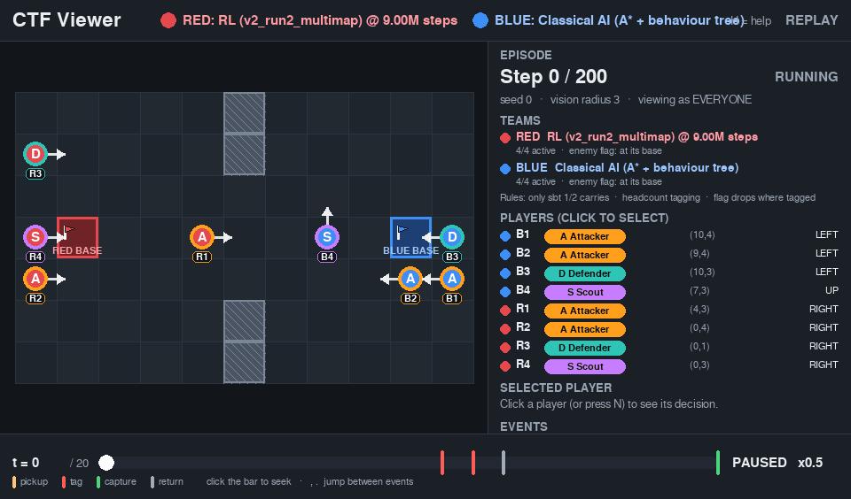

# Multi-Agent Capture the Flag: Classical AI vs MAPPO vs LLM Commander

Two teams of four agents fight over flags on a small grid with fog of war. This repository holds the game, three
very different ways to play it, a fair evaluation harness, and a viewer to watch it all.

<p align="center">
  
  <br><em>RED (trained MAPPO policy) against BLUE (alpha-beta minimax, depth 2): both attackers go in together,
  the first one takes the flag, the defender and scout stay home. Recorded headless with <code>python -m viz record</code>.</em>
</p>

BITS Pilani, CS F407 Artificial Intelligence, course project.

## Contents

1. [The game](#1-the-game)
2. [Three approaches](#2-three-approaches)
3. [The RL agent in detail (CNN + MAPPO)](#3-the-rl-agent-in-detail-cnn--mappo)
4. [Results](#4-results)
5. [The viewer (UI demo)](#5-the-viewer-ui-demo)
6. [Quick start](#6-quick-start)
7. [Training, evaluating, reproducing the figures](#7-training-evaluating-reproducing-the-figures)
8. [What is in the repository](#8-what-is-in-the-repository)
9. [Limits and honest notes](#9-limits-and-honest-notes)
10. [Documentation index](#10-documentation-index)

## 1. The game

An 11x7 grid, a wall in the middle with gaps, one base and one flag per team, **4 agents per team** and a
200-step limit. A team wins by carrying the enemy flag back onto its own base cell. The environment
(`src/ctf`) is deterministic: randomness only enters through seeded spawn positions.

| Rule (`configs/ctf_v2.yaml`) | What it means |
|---|---|
| Fog of war | An agent sees enemies and the enemy flag only within Manhattan radius 3. Teammates share what they see (a team belief map), so a scout's view helps everyone. |
| Roles by slot | Slots 1-2 are **attackers** (only they may pick up and carry the flag), slot 3 is the **defender**, slot 4 the **scout**. |
| Headcount tagging | A carrier is tagged only when enemies on its cell **outnumber** its non-carrier teammates there. A lone attacker loses to one defender; an attacker with one escort beats one defender. |
| Dropped flags | A tagged carrier is eliminated (no respawn) and its flag stays where it fell. An eligible enemy can pick it up again; an agent of the flag's own team touching it sends it home. |
| Draws | If nobody captures within 200 steps the game is a draw. |

`configs/default.yaml` keeps the original rules (3 agents, any enemy tags) so older results stay reproducible.
Every rule is a YAML key; the full specification is [docs/environment.md](docs/environment.md).

Seven 11x7 layouts live in `configs/maps/`. They are all left-right mirror-symmetric (so one policy can play both
sides through a mirrored view). The picture shows which layouts each RL training recipe used:



## 2. Three approaches

All three implement the same small interface (`strategies.BaseStrategy`: observation in, one action per agent out),
so any of them can play any other, in the evaluation harness and in the viewer.

| | Approach | Where | Idea |
|---|---|---|---|
| 1 | **Classical AI** | `src/classical_ai/` | A* path finding, an influence map of enemy danger, a small behaviour tree and one controller per role. Hand-written, no learning. Wrapped by `src/rl/classical_opponent.py` ([docs/classical.md](docs/classical.md)). |
| 2 | **RL: MAPPO with a CNN** | `src/rl/` | A CNN actor-critic with role-conditioned heads, trained with multi-agent PPO and a centralised critic. One network plays all four agents on either side. |
| 3 | **LLM commander** | `src/strategies/llm_commander/` | An LLM acts as a coach: every few turns it reads what the team knows and gives short orders ("attacker, capture the flag"). A low-level controller turns orders into moves; illegal orders are rejected before they reach the agents. Works with any provider (OpenAI-style, Anthropic, Gemini, local models) or an offline mock ([docs/llm_commander.md](docs/llm_commander.md)). |

Fixed reference opponents used for evaluation and training: `random`, `stay`, four scripted teams (`leash`,
`parked`, `chaser`, `escort`), and a **minimax opponent with alpha-beta pruning** (`src/rl/minimax.py`, depth 2 by
default, explained in [docs/minimax.md](docs/minimax.md); depth 3 was also measured, see `outputs/eval/`).



## 3. The RL agent in detail (CNN + MAPPO)

"A CNN trained with reinforcement learning": the policy is a small convolutional network over image-like channels of
the board, trained with **MAPPO** (multi-agent PPO).



* **Parameter sharing, role conditioning.** One network plays every slot; the role is an input and each role has its own
  action head. BLUE plays through a mirrored view, so one policy handles both sides.
* **Centralised critic, decentralised actor.** The critic sees the true global state during training only; the deployed
  actor uses only what its team can see.
* **Reward shaping, all in YAML** (`configs/rl/default.yaml`): win/loss, flag pickup, being tagged, potential-based
  progress towards the enemy flag and towards home while carrying (BFS path distance), an escort bonus, a defender
  intercept term, a fading scout exploration bonus. Weights differ by role so nobody free-rides.
* **Curriculum.** Phase 1 full view and far-corner spawns, phase 2 radius 6 with guards, phase 3 the real setting
  (radius 3, every opponent style, a pool of maps).
* **Multi-map training.** Each episode draws a map from a weighted pool; features, reward distances and the opponent are
  built for the drawn map ([docs/multimap.md](docs/multimap.md)). A start-up check refuses a pool map that is
  not symmetric, not connected, or that leaks into the held-out evaluation maps.
* **Everything tunable lives in strict YAML** (unknown or missing keys are errors, old checkpoints are migrated).

Code map: `networks.py` (model), `mappo.py` (update), `features.py` (observation tensors), `rewards.py`,
`env_wrapper.py` (training environment), `curriculum.py`, `trainer.py`, `evaluate.py`, `league.py` (optional
frozen-opponent training), `minimax.py`.

## 4. Results

Everything in this section comes from files in the repository (`outputs/eval/*.json`, `runs/*/metrics.jsonl`),
except the three-approach comparison, which is marked as copied from the research report. Evaluation protocol:
**200 games per opponent** (100 as RED, 100 as BLUE), fixed seed 2026, argmax actions, no opponent noise, random start
cells near the base, vision radius 3, Wilson 95% intervals (`configs/rl/eval.yaml`, [docs/evaluation.md](docs/evaluation.md)).

### 4.1 How training went


* **Run 1** (single map) won almost nothing for about 3 million steps (a "grab the flag and freeze" start; the cause
  is a hypothesis, not a finding), then climbed quickly once it found the route home.
* **Run 2** continued from Run 1's 6.0M checkpoint on a pool of five maps (9.0M steps).
* **Run 3** continued from Run 2 on all seven maps (11.0M steps). Its lower overall training win rate is expected: the
  pool now includes the two hardest layouts.



Honest detail from `runs/v2_run3_allmaps/metrics.jsonl`: on `long_wall_south` the training win rate is **0.0 in all 976
logged updates** even though that map has weight 2 in the pool, while `center_gate` rose from 0.77 to 0.88 (mean of the
first and last 200 updates). More training on that map did not help in the 2M steps that were run.

### 4.2 Win rate per opponent (200 games each)


| Opponent | Run 1 @ 6.0M (single map) | Run 2 @ 9.0M (5-map pool) |
|---|---|---|
| random | **85.5%** [80, 90] (D 29, L 0) | **93.0%** [89, 96] (D 14, L 0) |
| stay | **77.5%** [71, 83] (D 45, L 0) | **90.5%** [86, 94] (D 19, L 0) |
| scripted_leash | **95.5%** [92, 98] (D 8, L 1) | **98.0%** [95, 99] (D 4, L 0) |
| scripted_parked | **84.5%** [79, 89] (D 31, L 0) | **88.5%** [83, 92] (D 23, L 0) |
| scripted_chaser | **97.0%** [94, 99] (D 6, L 0) | **100.0%** [98, 100] (D 0, L 0) |
| scripted_escort | **95.0%** [91, 97] (D 10, L 0) | **98.0%** [95, 99] (D 4, L 0) |
| minimax (depth 2) | **100.0%** [98, 100] (D 0, L 0) | **93.5%** [89, 96] (D 13, L 0) |
| classical AI | **82.5%** [77, 87] (D 35, L 0) | **87.0%** [82, 91] (D 26, L 0) |

`[lo, hi]` is the Wilson 95% interval, D = draws, L = losses. Almost every non-win is a 200-step draw, not a loss.
Run 2 at 9.0M is *lower* than Run 1 against minimax (93.5% vs 100%): more training did not help against every
opponent. Files: `outputs/eval/v2_run1_6.0M.json`, `outputs/eval/v2_run2_9M.json`.

### 4.3 Does it work on maps it has not seen?



| Map | Run 1 @ 6.0M | Run 2 @ 9.0M | Seen by Run 2? |
|---|---|---|---|
| center_gate | **5.0%** [3, 10] | **50.6%** [43, 58] | **UNSEEN** |
| center_pillar | **89.4%** [84, 93] | **95.6%** [91, 98] | seen |
| long_wall_south | **0.0%** [0, 2] | **0.0%** [0, 2] | **UNSEEN** |
| open_field | **45.0%** [37, 53] | **90.6%** [85, 94] | seen |
| pillars | **51.9%** [44, 59] | **91.9%** [87, 95] | seen |
| two_corridors | **36.9%** [30, 45] | **96.2%** [92, 98] | seen |

160 games per map (four scripted opponents x 40). Training on a map pool fixed the layouts it trained on. Of the two maps
Run 2 never saw, one is about half solved and the other, `long_wall_south` (a wall with only a *bottom* gap), is a clean
failure: the policy heads for the top lane that its single-map training taught it. The viewer shows it:


### 4.4 Three approaches side by side (copied from the research report)


These two experiments are **not regenerated from files in this repository**; the counts are copied from Figures 6 and 7
of the research report into `configs/plots/readme_assets.yaml` (the figure script checks that each bar sums to its game
count).

* **Experiment A:** 42 fixed-spawn games, 28 per strategy. Classical AI 7 wins / 4 draws / 17 losses, MAPPO (13M steps)
  11 / 5 / 12, LLM commander 17 / 5 / 6. The report itself calls this a descriptive sample, not evidence of statistical
  significance or a general ranking.
* **Experiment B:** 70 games per pairing, minimax depth 2. The 13M MAPPO checkpoint scored 13 / 39 / 18 against minimax,
  the 9M checkpoint 25 / 45 / 0, and 13M against 9M went 1 / 56 / 13. The 9M checkpoint's 25 wins came with 45 draws; it
  won no game against minimax on `center_gate`, `long_wall_south` or `open_field`, and all 30 games on `long_wall_south`
  across the three pairings were draws.

Fixed spawns and 28-70 games are a different protocol from the 200-game near-base evaluation above, so do not compare
numbers across 4.2 and 4.4.

## 5. The viewer (UI demo)

`src/viz` is a Pygame viewer for live play and replays. Every player is labelled with its id and role, the right-hand
panel shows the rules, each agent's position and last action, an event log, and the bottom bar is a timeline with
pickup / tag / capture / return markers you can click to seek.


More recorded games (made with `python -m viz record`, no window needed). RL (RED) against the classical team, and a win
on `center_gate`, a layout Run 2 never trained on (a good seed, not the typical result, which is about half):

<p align="center">
  
  
</p>

What the viewer can do (press **H** in the window for every key; looks and keys live in `configs/viz/default.yaml`):

| Feature | How |
|---|---|
| Live play, any controller on either side | `python -m viz play --checkpoint <pt> --red RL --blue Minimax` (`F1`/`F2` cycle the controllers, `w` swaps sides, `return` new seed) |
| Controllers | RL checkpoint, random, stay, scripted variants, minimax, classical AI (original and `classical_fixed`), listed in `configs/viz/controllers.yaml` |
| Fog and vision | `f` fog, `v` vision, `tab` view as RED / BLUE / everyone |
| Replays and exports | `viz record`, `viz replay`, `viz export` to GIF, MP4 or PNG |
| Map maker | `python -m viz mapmaker --map configs/maps/default.yaml`: paint walls, bases and spawns, with a mirror mode that keeps maps symmetric |
| Learning over time | `python -m viz timelapse --run runs/v2_run1`: the same game played by checkpoints from early to late training |
| Training report | `python -m viz report --run runs/v2_run1`: one-page training dashboard |

The headless rendering was verified in a Linux sandbox; opening the live window on macOS is the one thing the checklist in
[docs/demo.md](docs/demo.md) asks you to do once before presenting.

## 6. Quick start

Requires [uv](https://docs.astral.sh/uv/) (Python 3.11+).

```bash
uv sync --extra dev --extra rl --extra viz        # environment + tests + PyTorch + viewer
uv run pytest -q                                  # the test suite

uv run python scripts/run_demo.py                 # text demo of a scripted episode

# watch a trained team (needs the viz extra and a display)
CK=runs/v2_run2_multimap/checkpoints/step_0009000960.pt
sh scripts/demo_prepare.sh $CK                    # near-base spawn copies of the maps + fallback GIFs
uv run python -m viz play --map outputs/viz/demo_maps/default.yaml --checkpoint $CK --red RL --blue Minimax --seed 0
uv run python -m viz play --map outputs/viz/demo_maps/default.yaml --checkpoint $CK --red RL --blue "Classical AI (A*" --seed 0
```

The LLM commander runs offline with a mock model (no key needed) and with a real provider after
`uv run python scripts/setup_llm.py`:

```bash
uv run python scripts/run_llm_commander.py                                    # mock LLM vs a scripted team
uv run python scripts/run_llm_commander.py --config configs/ctf_v2.yaml --condition llm_rl --rl-checkpoint $CK
uv run python scripts/run_experiments.py --dry-run                            # plan of the evaluation matrix
```

## 7. Training, evaluating, reproducing the figures

```bash
# train (a run lives in runs/<run.name>/: metrics.jsonl, config.yaml, checkpoints/, tensorboard/)
uv run python -m rl.benchmark --workers 0 2 3 --updates 2            # pick workers / threads for your machine
uv run python -m rl.train --set run.name=my_run --set rollout.num_workers=3
uv run python -m rl.train --set run.name=my_run --set rollout.num_workers=3 --resume latest
uv run tensorboard --logdir runs

# evaluate without any training noise (200 games per opponent, Wilson intervals, held-out maps, role-swap and
# argmax-vs-sampled checks)
uv run python -m rl.evaluate --checkpoint runs/v2_run2_multimap/checkpoints/step_0009000960.pt
uv run python -m rl.evaluate --checkpoint ... --opponents random scripted_chaser --set episodes=40   # quick look
```

The Colab commands behind the three runs (GPU, 2 workers, resume after a runtime restart, the exact `--set` flags) are in
`runs/*/run_info*.json` and in [docs/multimap.md](docs/multimap.md). Training speed was about 850 steps/s on a Colab T4 with 2
workers (an estimate from the first run; the sandbox used for verification manages 300-400 steps/s on one CPU core).

Rebuild every figure and screenshot of this README (no training or evaluation is run; it reads the committed files):

```bash
sh scripts/make_readme_assets.sh runs/v2_run2_multimap/checkpoints/step_0009000960.pt
```

This calls `scripts/make_rl_plots.py` (training curves, per-opponent and per-map bars), `scripts/make_readme_assets.py`
(map gallery and the report experiments) and `python -m viz record/export` (UI screenshots and GIFs); sizes and colours are in
`configs/plots/`.

## 8. What is in the repository

```
src/ctf/                 environment: rules, observations, config (strict YAML)
src/coordination/        shared team belief map (scout line-of-sight sharing)
src/strategies/          BaseStrategy interface, roles, the LLM commander (llm_commander/)
src/classical_ai/        approach 1, copied unchanged from the classical_ai branch
src/rl/                  approach 2: MAPPO, features, rewards, curriculum, evaluation, minimax, league, map pools
src/viz/                 the viewer, map maker, GIF/MP4 export, time-lapse, training report
configs/                 default.yaml, ctf_v2.yaml (rules), maps/, rl/ (training + evaluation), viz/, plots/
runs/                    committed training logs and a few checkpoints (below)
outputs/eval/            committed evaluation results (JSON) and the review log
scripts/                 demos, experiment runner, plot and asset scripts, LLM setup
docs/                    specification, evaluation, minimax, classical, multi-map, LLM commander, demo checklist
tests/                   unit and integration tests
```

Checkpoints in the repository (the rest were removed to keep the repository small; every file keeps its config inside):

| File | What it is |
|---|---|
| `runs/colab_run1/checkpoints/latest.pt` | the first run: 3 agents, original rules, 2M steps (baseline only; cannot play the 4-agent maps) |
| `runs/v2_run1/checkpoints/step_0006000640.pt`, `step_0008001536.pt` | Run 1 on the v2 rules, single map, at 6.0M and 8.0M steps |
| `runs/v2_run1/checkpoints/step_0013002752.pt` | 13.0M steps; the config stored inside names it `v2_pickup_finetune_r2` (a single-map fine-tune, learning rate 0.00003). Its training command is not in the repository |
| `runs/v2_run2_multimap/checkpoints/step_0007501824.pt`, `step_0009000960.pt` | Run 2, five-map pool, 7.5M and 9.0M steps. The 9.0M file is the one the demos and tables use |
| `runs/v2_run3_allmaps/` | Run 3 (all seven maps, 11.0M steps): logs and in-training evaluations only, no checkpoint file |

## 9. Limits and honest notes

* **One training seed per run**, so there is no seed-to-seed variance. Differences of a few points between checkpoints are
  inside the intervals.
* **Draws are the main non-win**, mostly 200-step timeouts. Against a team that never moves, the policy can still lose its
  attackers one by one to the headcount rule, which is a real weakness (traced in [docs/classical.md](docs/classical.md)).
* **Transfer is limited.** Only `center_gate` and `long_wall_south` were unseen for Run 2: about half, and zero. Layouts with a
  different size, non-symmetric walls, or very different base positions were never tried (the network shape contains the
  11x7 board, and the mirrored-BLUE trick needs symmetry).
* **More steps are not always better.** Run 2 at 9.0M is below Run 1 at 6.0M against minimax (table 4.2).
* **The scout often stands still.** Scout information sharing is a game rule (the team view is the union of all agents' views),
  not a tested hypothesis, and role specialisation is judged from behaviour numbers, not from the role-swap check.
* **Training win rate is not performance.** It includes sampled actions and opponent noise; only the 200-game evaluation
  counts.
* **Approach comparison.** Section 4.4 is a small descriptive sample copied from the report; the repository does not contain
  those games.
* **Not run by the author of this README:** the live Pygame window on macOS, PyTorch 2.2.2 on macOS 12 (the sandbox used
  PyTorch 2.14), live Colab training.

## 10. Documentation index

| Document | About |
|---|---|
| [docs/environment.md](docs/environment.md) | full environment specification and rules |
| [docs/evaluation.md](docs/evaluation.md) | the evaluation protocol, metrics and checks |
| [docs/multimap.md](docs/multimap.md) | map pools, the seen/unseen split, Run 2 and Run 3 recipes |
| [docs/minimax.md](docs/minimax.md) | the alpha-beta minimax opponent |
| [docs/classical.md](docs/classical.md) | the classical AI, its adapter and fixes |
| [docs/llm_commander.md](docs/llm_commander.md) | the LLM commander, providers and experiments |
| [docs/demo.md](docs/demo.md) | live-demo checklist, one command per demo |
| [docs/research_handoff_rl.md](docs/research_handoff_rl.md) | numbers and what must not be claimed, for the research record |
